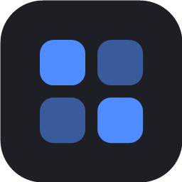
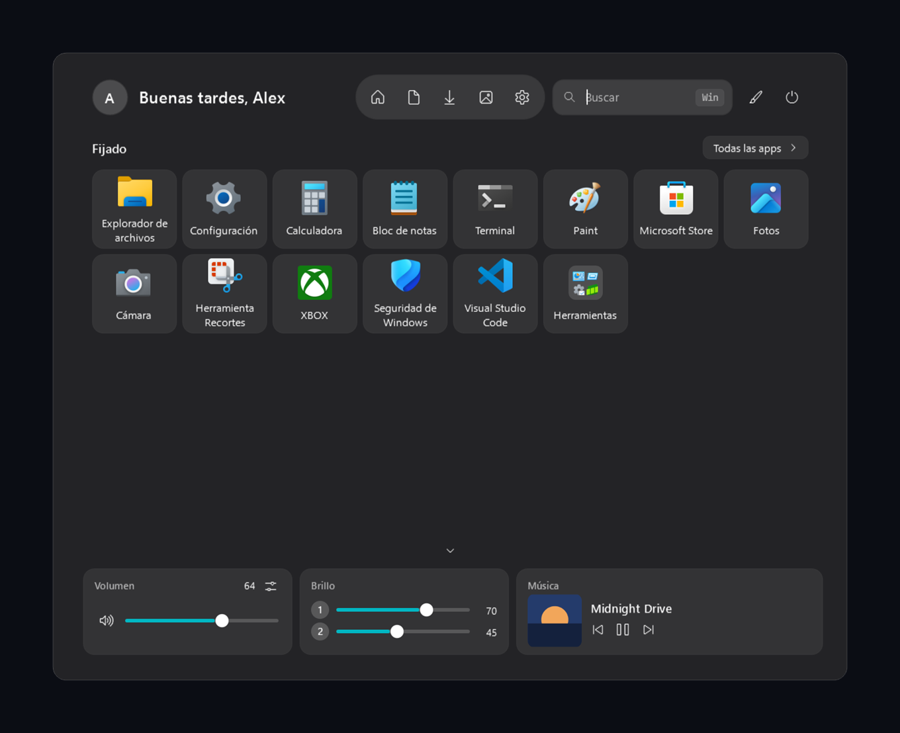
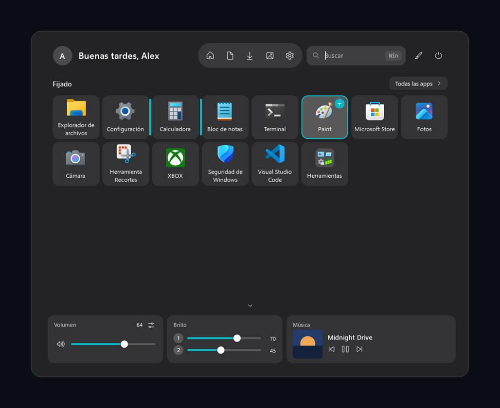
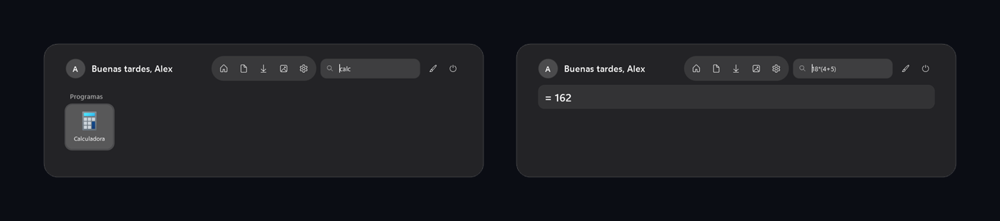
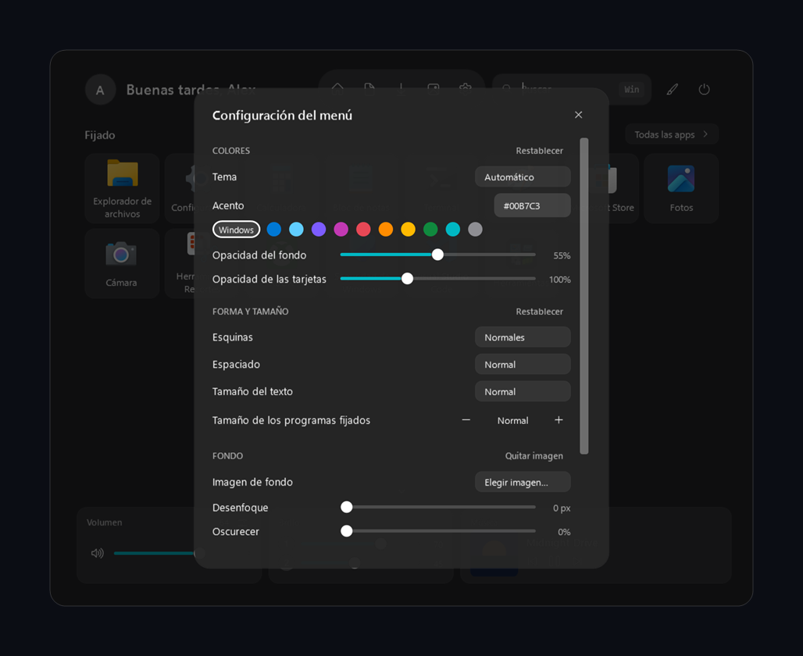
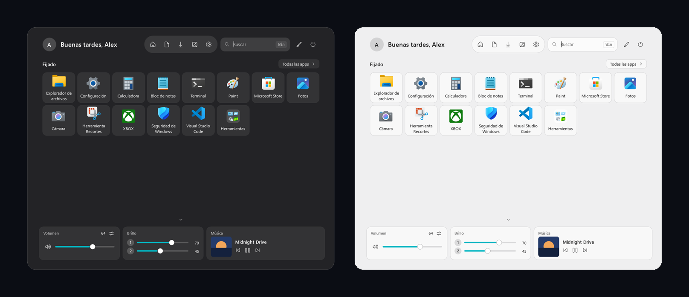
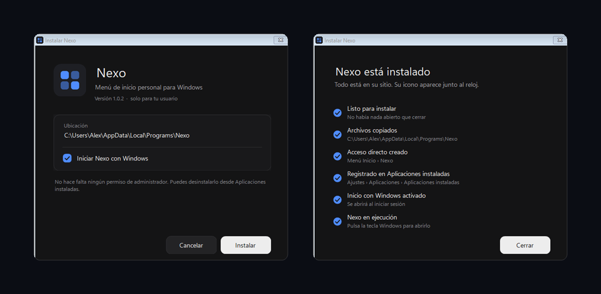

<p align="center">
  
</p>

<h1 align="center">Nexo</h1>

<p align="center">
  A calmer Start menu for Windows.<br>
  Press the Windows key and get your pinned apps, instant search, and a few small widgets — nothing else.
</p>

<p align="center">
  <a href="../../releases/latest"><b>Download for Windows</b></a> ·
  <a href="#features">Features</a> ·
  <a href="#install">Install</a> ·
  <a href="#build-from-source">Build from source</a>
</p>

<p align="center">
  
</p>

Nexo replaces the Start menu that opens with the Windows key (and with the Start button on the taskbar). It is a single small program with no installer dependencies, no account and no network access. Close it and Windows' own Start menu is back exactly as it was.

> **Language.** The menu itself is currently in Spanish. This page is in English; an English interface is the first thing on the [roadmap](#roadmap).

## Features

**Pinned apps and folders**
- Pin any app, drag tiles to reorder them, drop one tile on another to make a folder.
- Right-click a tile: open, open file location, run as administrator, pin or unpin, rename a folder.
- Arrow keys move through the tiles, Enter opens the selected one.



**Search that learns what you use**
- Type anywhere in the menu to search apps, Windows settings pages and files from the Windows search index.
- Results are ranked by how often you launch them, so the app you open ten times a day comes before one that merely matches better.
- Type a sum such as `18*(4+5)` and the answer shows up; click it to copy.
- "All apps" lists everything installed, with an A–Z jump.



**Widgets** (hide them all with the small tab above them)
- Volume, with a per-app mixer.
- Brightness for each monitor that supports it.
- Now playing: cover, title and previous / play / next for whatever is playing in Windows.

**Make it yours**
- Light, dark or follow Windows. Accent colour from a palette, a hex code, or Windows' own.
- Card shape (normal, square, round), spacing, text size, tile size, window height.
- Optional background picture with blur and dim; text colour adapts to the picture.
- Your own profile picture.
- Back up and restore layout and settings as a single `.zip`.





**Details that matter**
- The menu is kept warm in memory, so it opens at once; panels fade and scale in and out.
- Works over borderless full-screen games: the taskbar is brought back while the menu is open and put away when it closes.
- Windows shortcuts such as `Win+E` or `Win+D` keep working; only a *lone* tap of the Windows key opens Nexo.
- Icons are cached for instant paint but re-checked in the background, so an app that changes its icon shows the new one within hours (tray icon → *Actualizar iconos* forces it now).
- A dock with your personal folders and Windows Settings, and a power menu.
- Starts with Windows if you want it to (tray icon → *Iniciar con Windows*).

## Install

1. Download `Nexo-Setup.exe` from the [latest release](../../releases/latest).
2. Run it. It installs for your user only (no administrator rights), adds a shortcut and an entry in *Installed apps*, and starts Nexo.
3. Press the Windows key.

The installer shows each step as it happens and finishes with a checklist, so you can see exactly what was installed and where. To remove Nexo use *Settings → Apps → Installed apps → Nexo*; you can keep or delete your settings.



### About antivirus warnings

Nexo is **not code-signed**, and it does two things security software watches closely: it listens for the Windows key and for clicks on the taskbar Start button, and it can start with Windows. For that reason Windows SmartScreen may warn on first run, and Microsoft Defender's machine-learning detection has flagged a build as a generic trojan before.

It is a false positive, and everything is here to read and build yourself (see below). If your antivirus blocks it, add `%LocalAppData%\Programs\Nexo` to its exclusions. Nexo never makes network connections; the hooks only look for a lone Windows key press and for clicks on the Start button, and nothing is recorded.

## How it works

- **One file of code per concern.** `src/Program.cs` is the menu, `src/Widgets.cs` is audio / brightness / media, `src/Menu.xaml` is the whole interface. WPF, C# 5, no dependencies beyond the .NET Framework that ships with Windows.
- **Keyboard and mouse hooks** run on their own thread, so a slow window can never stall your input. They swallow a lone Windows key (and the Start button click) and ask the menu to toggle.
- **Acrylic blur** comes from the same Windows composition call the shell uses; the window itself never moves, only its content slides, so the blur is not recomputed every frame.
- **Your data** lives in `%AppData%\Nexo` (`layout.json`, `prefs.json`, picture files). Nothing is sent anywhere.

## Build from source

You only need Windows. The compiler (`csc.exe`) is part of the .NET Framework already installed with Windows; there is no SDK, no NuGet, no package restore.

```powershell
git clone https://github.com/VuloB1/nexo.git
cd nexo
powershell -File build.ps1          # builds Nexo.exe
powershell -File build-setup.ps1    # builds dist\Nexo-Setup.exe (embeds Nexo.exe)
```

Run `Nexo.exe` directly to try it. Only one copy runs at a time.

### Screenshots and tests

`Nexo.exe --shot out.png` renders the menu to an image without showing it. Useful options: `--theme light|dark`, `--search text`, `--menu cfg|drop|nav|letters`, `--look "#E74856,30,200"`.

The pictures on this page were made with a neutral name, an empty data folder and fixed widget content, using three environment variables that exist only for this: `NEXO_USER`, `NEXO_DATA`, `NEXO_DEMO=1`. `tools/make-docs-images.ps1` turns the raw captures in `docs/screenshots` into the images in `docs/img`.

## Requirements

- Windows 10 or 11, 64-bit. Built and tested on Windows 11 (IoT Enterprise LTSC 2024); Windows 10 should work but is untested.
- Brightness control uses DDC/CI, so it needs a monitor that accepts it (most external monitors do; some laptop panels do not).

## Roadmap

- English interface (and a language setting).
- A signed build, so SmartScreen and antivirus stop asking questions.
- More widgets (clipboard history, quick screenshots).

## License

[MIT](LICENSE)
